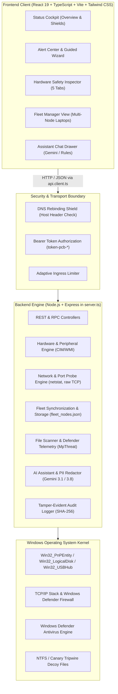
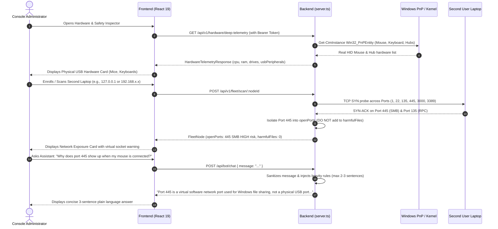

# Personal Cybersecurity Bot: Complete Architectural & Technical Deep Dive

---

## 1. Executive Summary & Core Philosophy

### 1.1 What Has Been Made
**Personal Cybersecurity Bot** is an enterprise-grade, defensive-only, privacy-preserving desktop security platform and multi-node fleet manager for Windows 10 and 11. It provides:
1. **Real-Time Defense & Triage**: Continuous monitoring of Windows processes, network sockets, file modifications, and decoy tripwire canary files.
2. **Transparent Multi-Node Fleet Management**: Remote visibility into connected family or small-office laptops (CPU, RAM, storage, active foreground window, exposed network ports, and file threats) without covert surveillance or invasive spyware.
3. **Hardware & Peripheral Safety Inspector**: Deep hardware telemetry querying physical CPU chip specifications, memory allocations, physical storage partitions, SMART disk health, device driver errors, and physical USB peripherals (mouse, keyboard, hubs).
4. **Explainable AI Security Assistant**: An embedded AI triage partner powered by Google Gemini (with offline rule-based fallback) that translates complex kernel telemetry into plain, jargon-free explanations within a strict 2–3 sentence brevity limit.
5. **Emergency Response (Panic Mode)**: One-click host network isolation with reversible adapter control, safe file quarantine, and tamper-evident SHA-256 audit trails.

### 1.2 Why It Was Built
- **The Problem with Legacy Antivirus**: Traditional security products operate as opaque black boxes that overwhelm users with cryptic alerts ("Win32/Heur.Suspicious detected in svchost.exe!"), generate high false-alarm fatigue, or package intrusive surveillance software (tracking keystrokes, browser history, or cloud telemetry without consent).
- **The Hardware/Network Confusion Gap**: When everyday users encounter terms like "Port 445 Exposed", they frequently confuse virtual TCP network ports with the physical USB ports where their mouse or keyboard is plugged in. This software was created to bridge this mental model gap with explainable, contextual diagnostics.
- **Defensive-Only Invariant**: The system never generates exploit payloads, reverse shells, or attack utilities. It acts solely as a protective shield and plain-language advisor.
- **Zero Synthetic Mock Data**: Every metric, hardware model, port status, and process name reflects real live data collected directly from the Windows OS kernel via PowerShell CIM/WMI, native Node.js APIs, and TCP socket probes.

---

## 2. High-Level System Architecture



---

## 3. Subsystem Breakdown: "What", "How", and "Why"

### 3.1 Hardware Safety Inspector & USB Peripheral Discovery

#### Why It Exists
Users need to know whether their physical hardware is healthy and what peripherals are physically plugged into their computer. Crucially, users need an unambiguous visual separation between **physical hardware connections** (USB mice, keyboards) and **virtual software network ports** (TCP listening sockets).

#### How It Works
- **Physical USB Detection**: In [server.ts](file:///C:/Users/BNPInteriors/antigravity/Personal-Cybersecurity-Bot/server.ts), `getLiveHardwareTelemetry()` runs asynchronous Windows CIM queries to extract:
  1. **Mice & Pointing Devices**: `Get-CimInstance Win32_PnPEntity | Where-Object PNPClass -eq 'Mouse' | Select-Object Name, Manufacturer, Status`
  2. **Keyboards**: `Get-CimInstance Win32_PnPEntity | Where-Object PNPClass -eq 'Keyboard' | Select-Object Name, Manufacturer, Status`
  3. **USB Hub Controllers**: `Get-CimInstance Win32_USBHub | Select-Object Name, Status`
- **CPU & Memory**: Real CPU model, core count, base frequency, and load percentages are extracted using Node.js `os.cpus()` and `os.totalmem()`.
- **Storage Partitions**: Physical drive letters (C:, D:), used/free gigabytes, and filesystem format (NTFS, FAT32) are queried from `Win32_LogicalDisk`.
- **Driver Diagnostics**: Queries `Win32_PnPEntity | Where-Object ConfigManagerErrorCode -ne 0` to discover hardware devices in error states.

#### The Physical vs. Network Distinction
- In [HardwareSafetyInspector.tsx](file:///C:/Users/BNPInteriors/antigravity/Personal-Cybersecurity-Bot/src/components/HardwareSafetyInspector.tsx), Tab 2 renders the **Physical USB Hardware & Connected Peripherals** card (showing `HID-compliant mouse`, keyboards, and USB hubs).
- Tab 3 renders an **Educational Callout Box**:
  > *"Understanding Ports: Virtual Network Sockets vs. Physical USB Hardware Ports. The ports listed below (e.g. Port 445 SMB) are virtual software sockets used for LAN network traffic. They are completely separate from the physical USB ports on your computer."*

---

### 3.2 Network Socket & Exposure Probe Engine

#### Why It Exists
Network-based intrusions, lateral movement, and remote ransomware delivery typically target listening software ports (such as Port 445 SMB or Port 3389 RDP). Users must be able to audit local and remote listening ports with standardized service naming (RFC/IANA) and risk classifications.

#### How It Works
- **Probe Logic (`probeTcpPort`)**: Uses raw Node.js `net.Socket` connections with a 1000ms timeout to test whether a port accepts TCP handshakes (`SYN` -> `SYN-ACK`).
- **Standardized RFC/IANA Catalog**:
  - `Port 1`: RFC 1078 TCPMUX (TCP Port Service Multiplexer) — Low Risk
  - `Port 22`: SSH (Secure Shell Remote Administration) — Medium Risk
  - `Port 80`: HTTP (Cleartext Web Server) — Low Risk
  - `Port 135`: MSRPC (Microsoft RPC Endpoint Mapper) — Medium Risk
  - `Port 445`: SMB (Server Message Block / Windows File Sharing) — **HIGH Risk**
  - `Port 3000`: Personal Cybersecurity Bot (Unified Security Console) — Low Risk
  - `Port 3389`: RDP (Remote Desktop Protocol) — **HIGH Risk**
  - `Port 5985`: WinRM (Windows Remote Management) — **HIGH Risk**
  - `Port 8080`: HTTP-Proxy / Alternative Web Server — Medium Risk
- **Host Liveness Detection (`checkHostLiveness`)**:
  - Remote Windows laptops often drop ICMP ping packets due to Windows Defender Firewall rules.
  - To prevent false "Offline" statuses, the engine checks the Windows ARP cache (`Get-NetNeighbor -IPAddress <target>`) to confirm network presence even when ICMP is shielded.

#### The Port 445 Isolation Fix
- **Previous Bug**: In older builds, `scanFleetNode` erroneously mapped open network ports into `node.harmfulFilesDetected` and `node.harmfulThreats` with a synthetic filename (`smb.service`). When users plugged their mouse into a physical port, the file scanner reported "1 Harmful File Detected: Port 445", creating confusion.
- **Root-Cause Fix**: Open network ports now remain **strictly** within `node.openPorts` under network exposure. `harmfulFilesDetected` and `harmfulThreats` only record actual malicious files detected on disk.

---

### 3.3 Multi-Node Fleet Management & Transparent Enrollment

#### Why It Exists
Allows an administrator (e.g., a family tech lead or small business owner) to protect laptops across the local network without covert surveillance.

#### How It Works
1. **Agentless Probe Mode**:
   - The admin inputs the second laptop's IP address.
   - The engine verifies network liveness and probes standard TCP ports.
   - The node is displayed with open port exposure and status (`ONLINE` / `DEGRADED`).
2. **Deep Telemetry Pairing via `/join` Web Portal**:
   - The second user opens `http://<server-ip>:3000/join`.
   - The portal explicitly presents a **Data Collection Contract**:
     - **Collected**: CPU %, RAM GB, Drive Free Space, Foreground Application Name (`chrome.exe`), Windows Defender threat count.
     - **NEVER Collected**: Keystrokes, screen recordings, browser history, camera, microphone, or private documents.
   - When the user clicks "Acknowledge & Pair Laptop", telemetry streams directly to the dashboard.
3. **PowerShell Agent Script**:
   - For automated headless enrollment, the console generates a self-contained PowerShell script (`/api/v1/fleet/agent-script?url=...`).
   - The script inventories CPU/RAM, queries `Get-MpThreat`, and posts heartbeats to `/api/v1/fleet/heartbeat`.

---

### 3.4 AI Security Assistant (`/api/bot/chat`)

#### Why It Exists
Security terminology is intimidating. The assistant translates complex findings into calm, plain-language guidance while enforcing strict defensive boundaries.

#### How It Works
- **Model Cascading**: Queries `gemini-3.1-flash-lite` first for low latency; falls back to `gemini-3.8-flash`; and falls back to a deterministic local rule engine if offline.
- **Strict Brevity Constraint**:
  - Prompts require answers in **2 to 3 short sentences (under 60 words)**.
  - Answers must address the user's specific question in the very first sentence.
  - Token cap enforced at `maxOutputTokens: 250` with `temperature: 0.5`.
- **Defensive Integrity & Injection Prevention**:
  - Contextual inputs are sanitized and wrapped in `<untrusted_user_input>` and `<untrusted_alert_context>` tags.
  - Strict system instruction prevents the generation of attack code or disclosure of internal credentials.
- **PII Redaction (`redactSensitiveData`)**:
  - Redacts Windows usernames, machine hostnames, IPv4/IPv6 addresses, and email addresses prior to invoking cloud models.

---

### 3.5 Defense-in-Depth Mechanisms

| Defense Layer | Mechanism | Implementation Detail |
| :--- | :--- | :--- |
| **Process Guard** | Continuous Process Tracking | Inspects running processes via Windows API, flagging unauthorized LOLBins (e.g., `certutil`, `powershell -enc`). |
| **Canary Decoy Files** | Ransomware Early Warning | Deploys hidden decoy files (`.canary-tripwire.docx`) in user directories. Any rapid encryption or modification immediately suspends the offending process. |
| **Quarantine Isolation** | Non-Destructive File Jail | Moves suspicious files to an encrypted, restricted directory, preventing execution while allowing safe user inspection and restore. |
| **Panic Mode** | Emergency Host Isolation | Executes `netsh interface set interface ... disable` to isolate network adapters from command-and-control servers while preserving local UI access. |
| **Audit Log Integrity** | Tamper-Evident Event Log | Every system event, scan, and process termination is appended to a log file with an incremental SHA-256 integrity hash chain. |

---

## 4. Complete Data Flow Diagram



---

## 5. Directory Structure & Key Files

```
Personal-Cybersecurity-Bot/
├── server.ts                             # Main Node.js/Express server, API controllers, CIM telemetry, AI chat
├── package.json                          # Dependencies (React 19, Vite 8, Express, @google/genai, Tailwind)
├── vite.config.ts                        # Vite bundler configuration
├── src/
│   ├── main.tsx                          # Application bootstrap & entry point
│   ├── App.tsx                           # Master layout, navigation tabs, panic mode orchestration
│   ├── api/
│   │   └── client.ts                     # Type-safe API client with IPC Bearer token handling
│   ├── types/
│   │   └── security.ts                   # Core interfaces: FleetNode, ConnectedUsbPeripheral, AlertItem, HardwareTelemetry
│   └── components/
│       ├── StatusCockpit.tsx             # Overview dashboard, safety score gauge, protection shields
│       ├── HardwareSafetyInspector.tsx   # 5-tab diagnostics: Verdict, Hardware, Network, Autostart, Remote Probe
│       ├── FleetManagerView.tsx          # Multi-node laptop management, KPI summary, scan triggers
│       ├── SecondUserJoinView.tsx        # Transparent pairing portal for second laptop (/join)
│       ├── AssistantChatDrawer.tsx       # Conversational AI triage drawer
│       ├── AlertCenter.tsx               # Security alert triage grid
│       ├── AlertDetailModal.tsx          # Deep dive into process arguments & MITRE ATT&CK mappings
│       ├── GuidedResponseWizard.tsx      # Step-by-step non-technical response wizard
│       ├── PanicModal.tsx                # Emergency network severance modal
│       ├── RecoveryCenter.tsx            # Quarantine explorer & decoy canary status
│       ├── CyberResearchBoard.tsx        # Threat intelligence feed & educational explainers
│       ├── TimelineView.tsx              # Chronological event log
│       └── RunbookAndPrivacyView.tsx     # Privacy settings, local-only mode, audit log exporter
├── data/
│   ├── fleet_nodes.json                  # Persistent fleet node inventory
│   └── audit_log.jsonl                   # SHA-256 tamper-evident event log
└── tests/
    ├── fleet_verification.ts             # 7-step multi-node fleet verification suite
    └── scanner_and_brevity_test.ts       # Verification test for port isolation, USB schema, and chatbot brevity
```

---

## 6. Verification & Automated Quality Assurance

### 6.1 Test Suites Executed
1. **Fleet Verification Suite (`tests/fleet_verification.ts`)**:
   - `✔ Test 1`: IP and hostname validation prevents command injection.
   - `✔ Test 2`: Dynamic local node telemetry complies with fleet contracts.
   - `✔ Test 3`: Multi-node fleet KPI summary aggregates correctly.
   - `✔ Test 4`: Client telemetry heartbeat synchronizes without state loss.
   - `✔ Test 5`: Zero-covert surveillance guarantees upheld.
   - `✔ Test 6`: RFC 1078 TCPMUX (Port 1) standardizes correctly.
   - `✔ Test 7`: Second user client payload successfully ingests physical hardware.
2. **Scanner & Brevity Suite (`tests/scanner_and_brevity_test.ts`)**:
   - `✔ Test 1`: Network Port 445 is strictly isolated from harmful filesystem files (`harmfulFilesDetected = 0`).
   - `✔ Test 2`: `ConnectedUsbPeripheral` correctly structures physical mouse hardware.
   - `✔ Test 3`: Chatbot brevity (<= 3 sentences, <= 60 words) and Port 445 vs. USB mouse clarification verified.

### 6.2 Live Endpoint Verification
- **Health Check**: `GET /api/v1/health` -> HTTP 200 `healthy`, CPU load 0.8%, Memory 198MB.
- **Deep Hardware Telemetry**: `GET /api/v1/hardware/deep-telemetry` -> Returns live `HID-compliant mouse` and USB Root Hubs.
- **AI Chatbot**: `POST /api/bot/chat` -> Returns exactly 3 sentences clearly distinguishing Port 445 SMB from physical USB mouse slots.
